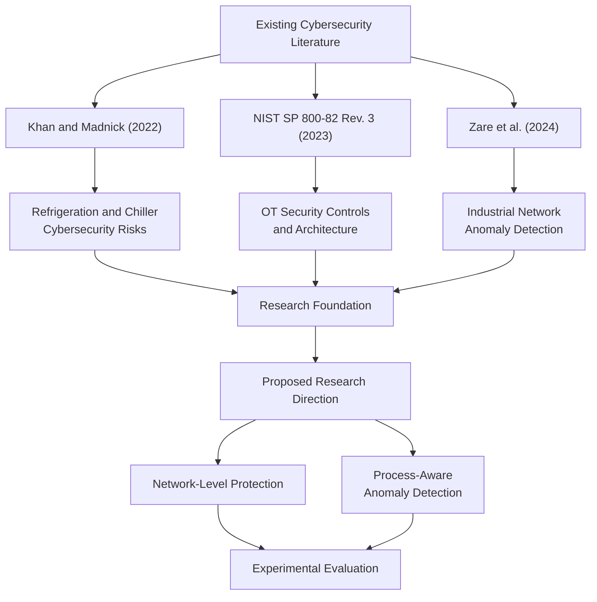
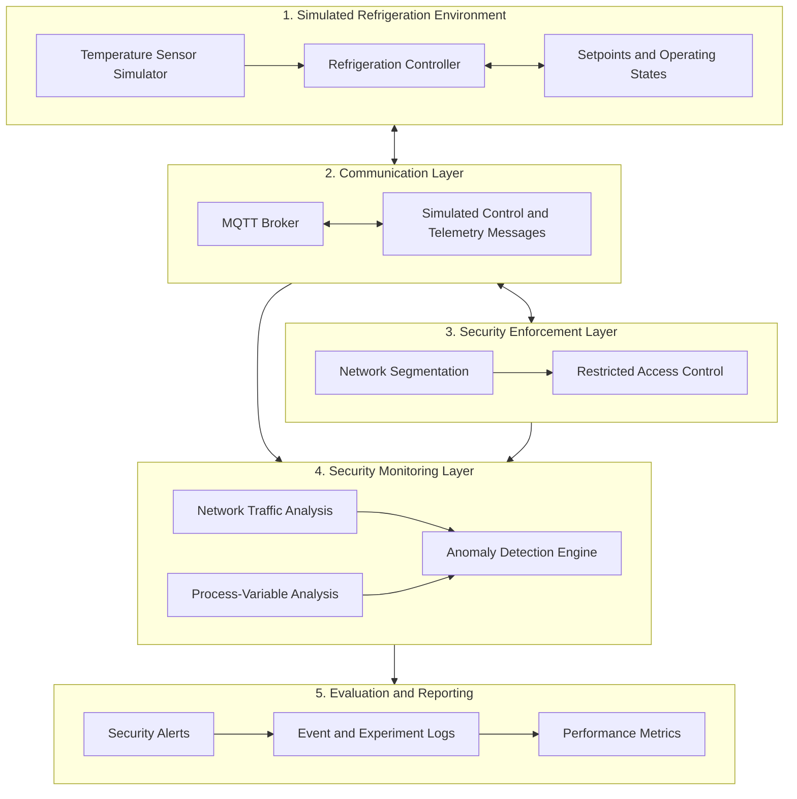
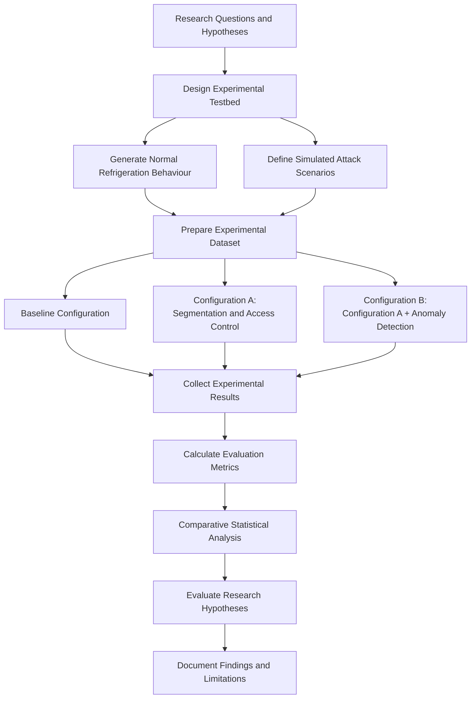
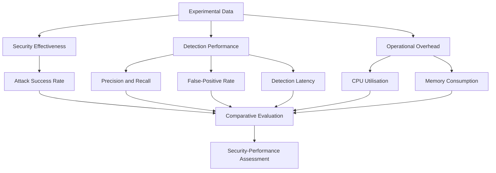

# Research Diagrams and Conceptual Models

**Project:** Cybersecurity of Internet-Connected Supermarket Refrigeration Systems

**Document Type:** Research Architecture and Methodology Visualisation

**Status:** Preliminary Research Design

---

## 1. Literature Synthesis and Research Foundation

The following conceptual diagram illustrates how the three foundational publications inform different aspects of the proposed research.

**Interpretation**

The literature establishes three complementary foundations:

- Refrigeration-specific cybersecurity risks.
- Security architecture and protective controls for OT environments.
- Anomaly detection in industrial network communications.

The proposed study investigates their application within a controlled supermarket refrigeration simulation. This diagram represents the conceptual relationship between the literature and the research direction; it does not imply that the existing publications proposed the combined framework.

---

## 2. Proposed Cybersecurity Framework Architecture

This diagram illustrates the planned software-based experimental architecture.

**Architecture description**

The proposed architecture consists of five logical layers:

**Layer 1 — Simulated Refrigeration Environment**

Generates temperature readings, setpoints, equipment states, and simulated control activities.

**Layer 2 — Communication Layer**

Represents communication between the simulated refrigeration components using MQTT, subject to final implementation decisions.

**Layer 3 — Security Enforcement Layer**

Implements network-level isolation and restricted access to reduce unauthorised communication and control activities.

**Layer 4 — Security Monitoring Layer**

Analyses network events and refrigeration process variables to identify suspicious behaviour.

**Layer 5 — Evaluation and Reporting Layer**

Records security events, detection outcomes, and performance measurements for comparative analysis.

**Design note:** This is a proposed architecture, not an implemented system. Exact component placement, traffic paths, and enforcement mechanisms will be finalised during testbed design.

---

## 3. Experimental Research Methodology

The experimental workflow will compare three security configurations under consistent normal and simulated adversarial conditions.

**Experimental workflow**

1. Develop a controlled software-based refrigeration simulation.
2. Define normal operating conditions and simulated adversarial events.
3. Prepare labelled experimental scenarios.
4. Execute the scenarios under all three security configurations.
5. Collect logs, detection outcomes, and resource measurements.
6. Calculate evaluation metrics.
7. Compare results and assess the research hypotheses.
8. Document findings, limitations, and reproducibility details.

---

## 4. Comparative Security Configuration

| Configuration | Network Segmentation | Restricted Access | Anomaly Detection |
|---|---|---|---|
| Baseline | No additional segmentation | No additional access restrictions | Disabled |
| Configuration A | Enabled | Enabled | Disabled |
| Configuration B | Enabled | Enabled | Enabled |

The baseline represents the experimental reference condition, not a recommendation to operate real refrigeration equipment without security controls.

---

## 5. Experimental Evaluation Metrics

The evaluation will examine both preventive and detective security capabilities. Results will be derived from executed experiments rather than estimated or assumed values.

---

## 6. Research Design Status

| Component | Current status |
|---|---|
| Literature foundation | Initial review completed |
| Conceptual research direction | Preliminary |
| Security architecture | Proposed |
| Experimental workflow | Planned |
| Simulation implementation | Not started |
| Experimental validation | Pending |
| Quantitative results | Pending |

**Research integrity statement:** All diagrams represent proposed research concepts and planned experimental procedures. They should not be interpreted as evidence of an implemented or experimentally validated system.
